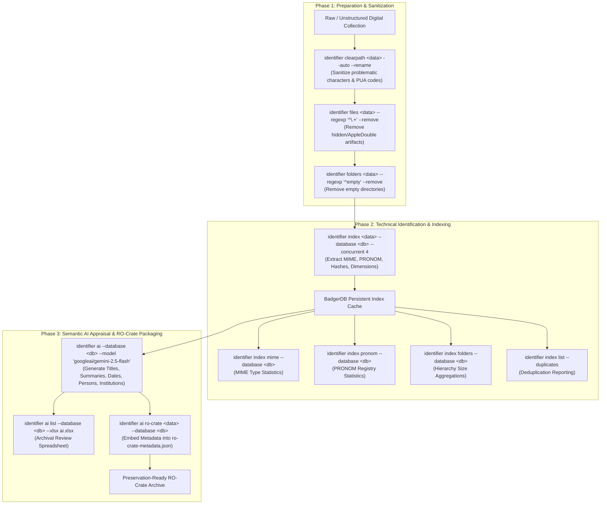

# identifier

`identifier` is a high-performance command-line tool and Go library designed for **technical metadata identification**, **filesystem sanitization**, **format characterization**, and **AI-assisted archival appraisal & semantic description** for weakly structured digital collections and research datasets.

It is developed by the [University Library Basel](https://ub.unibas.ch/) as part of the [`ocfl-archive`](https://github.com/ocfl-archive) digital preservation ecosystem.

---

## Table of Contents

- [Overview & Key Features](#overview--key-features)
- [Archival Processing Pipeline](#archival-processing-pipeline)
- [Installation & Prerequisites](#installation--prerequisites)
- [Quick Start Tutorial](#quick-start-tutorial)
- [CLI Command Reference](#cli-command-reference)
  - [`clearpath` — Filename Sanitization](#clearpath--filename-sanitization)
  - [`files` — Regex File Search & Deletion](#files--regex-file-search--deletion)
  - [`folders` — Regex Directory Search & Deletion](#folders--regex-directory-search--deletion)
  - [`index` — Technical Metadata Extraction & Indexing](#index--technical-metadata-extraction--indexing)
  - [`index list` — Query Stored File Metadata](#index-list--query-stored-file-metadata)
  - [`index folders` — Hierarchical Folder Statistics](#index-folders--hierarchical-folder-statistics)
  - [`index mime` — MIME Type Distribution Statistics](#index-mime--mime-type-distribution-statistics)
  - [`index pronom` — PRONOM Format Registry Statistics](#index-pronom--pronom-format-registry-statistics)
  - [`ai` — AI-Assisted Archival Appraisal & Description](#ai--ai-assisted-archival-appraisal--description)
  - [`ai list` — Query Stored AI Metadata](#ai-list--query-stored-ai-metadata)
  - [`ai ro-crate` — Export to RO-Crate 1.1 Metadata](#ai-ro-crate--export-to-ro-crate-11-metadata)
- [AI-Assisted Exploration & Appraisal Guide](#ai-assisted-exploration--appraisal-guide)
- [Data Storage & Output Formats](#data-storage--output-formats)
- [Configuration](#configuration)
- [Documentation Index](#documentation-index)
- [License](#license)

---

## Overview & Key Features

When cultural heritage institutions, research repositories, and archives receive digital donations or legacy estates ("schwach strukturierte Datenpakete"), they often encounter uncurated folder trees with illegal filesystem characters, duplicate files, unknown file formats, and missing descriptive metadata.

`identifier` solves these challenges across three distinct phases:

1. **Filesystem Cleaning & Sanitization**:
   - Depth-first bottom-up renaming to resolve illegal characters, Unicode Private Use Area (PUA) codes, control characters, leading dots/tildes, and typographic quotes.
   - Pattern-based file and folder discovery and selective removal (e.g. `.DS_Store`, AppleDouble files, empty directories).
2. **Technical Metadata Identification & Deduplication**:
   - Multi-engine format identification powered by [Siegfried](https://www.itforarchivists.com/siegfried) (PRONOM IDs, MIME types), [FFprobe](https://ffmpeg.org/ffprobe.html) (audio/video durations, codecs), [ImageMagick](https://imagemagick.org) (image dimensions), [Apache Tika](https://tika.apache.org/), and XML/JSON validators.
   - High-speed concurrent worker pools with SHA-512 cryptographic hashing and bit-level duplicate detection.
   - Embedded [BadgerDB](https://dgraph.io/docs/badger/) key-value caching for instant offline queries and statistical aggregations without rescanning disks.
3. **AI-Assisted Appraisal & Archival Description ("Erschliessung")**:
   - Integration with Google Gemini, OpenAI, and CEDA LiteLLM via [Firebase Genkit](https://firebase.google.com/docs/genkit).
   - Contextual folder tree sampling to extract scientific titles, archival summaries, temporal ranges, geographic locations, persons with roles, institutions, and media classification tags.
   - Automated packaging into standardized [RO-Crate 1.1](https://www.researchobject.org/ro-crate/1.1/) JSON-LD metadata descriptors (`ro-crate-metadata.json`).

---

## Archival Processing Pipeline



---

## Installation & Prerequisites

### Installation via Go

```shell
go install github.com/ocfl-archive/identifier/cmd/identifier@latest
```

### External Dependencies

For technical identification actions, `identifier` interacts with standard archival tools if configured:
- **[Siegfried](https://www.itforarchivists.com/siegfried)** (recommended for PRONOM format identification)
- **[FFprobe / FFmpeg](https://ffmpeg.org/)** (for audio/video duration and stream metadata)
- **[ImageMagick](https://imagemagick.org)** (`identify` for image dimensions)
- **[Apache Tika](https://tika.apache.org/)** (for text and document parsing)

---

## Quick Start Tutorial

### Step 1: Sanitize Filenames

Inspect and sanitize problematic characters (dry-run first, then execute with `--rename`):

```shell
# Dry-run preview
identifier clearpath C:/data/collection --auto

# Apply renaming
identifier clearpath C:/data/collection --auto --rename
```

### Step 2: Index Technical Metadata

Index the files into a persistent Badger database and export structured reports:

```shell
identifier index C:/data/collection \
  --database C:/data/index_db \
  --jsonl C:/data/index.jsonl \
  --csv C:/data/index.csv \
  --xlsx C:/data/index.xlsx \
  --concurrent 4 \
  --console
```

### Step 3: Inspect Statistics

Generate instant offline summary tables from the Badger database:

```shell
# MIME type statistics
identifier index mime --database C:/data/index_db --console

# PRONOM format statistics
identifier index pronom --database C:/data/index_db --console

# Directory size and file count aggregation
identifier index folders --database C:/data/index_db --console

# List all duplicate files
identifier index list --database C:/data/index_db --duplicates --console
```

### Step 4: AI Semantic Enrichment & RO-Crate Export

Generate archival folder descriptions using Google Gemini and embed them into `ro-crate-metadata.json`:

```shell
# Set your API key
export GEMINI_API_KEY="your-gemini-api-key"

# Generate AI descriptions and save to database + spreadsheet
identifier ai \
  --database C:/data/index_db \
  --model "googleai/gemini-2.5-flash" \
  --apikey "%%GEMINI_API_KEY%%" \
  --xlsx C:/data/ai_descriptions.xlsx \
  --console

# Write AI metadata into RO-Crate descriptor
identifier ai ro-crate C:/data/collection \
  --database C:/data/index_db \
  --model "googleai/gemini-2.5-flash"
```

---

## CLI Command Reference

### Global Flags

All commands accept the following persistent flags:

| Flag | Type | Default | Description |
|---|---|---|---|
| `--config` | string | `""` | Path to custom TOML configuration file (defaults to embedded configuration) |
| `--log-file` | string | `""` | Path to write structured log output (defaults to console stderr) |
| `--log-level` | string | `"WARN"` | Log verbosity: `ERROR`, `WARN`, `INFO`, `DEBUG` |
| `--autoconfig` | bool | `false` | Enable indexer autoconfig optimization |
| `--show-config` | bool | `false` | Print currently loaded TOML configuration to stdout and exit |

---

### `clearpath` — Filename Sanitization

Sanitizes file and folder names bottom-up using built-in archival rules or custom regular expressions.

```shell
identifier clearpath <path-to-data> [flags]
```

#### Flags:
- `--auto`: Apply built-in archival sanitization rules:
  - Replaces forbidden filesystem characters (`*`, `:`, `<`, `>`, `|`, `{`, `}`) and control codes with `_`.
  - Removes Unicode Private Use Area (PUA) characters (`U+E000` to `U+F8FF`).
  - Normalizes quotes (`‘’“”` to standard ASCII quotes `"` or `'`).
  - Collapses consecutive whitespace into a single space.
  - Replaces em-dashes `—` with `-`.
  - Replaces leading dots (`.`) with `_` and leading tildes (`~`) with `-`.
- `--rename`: Actually perform renaming on the filesystem. When omitted, runs in **dry-run mode** (preview only).
- `--regexp <pattern>`: Use a custom Go regular expression to match substrings to rename.
- `--replace <replacement>`: Replacement string for custom regexp matches (required together with `--regexp`).

#### Example:
```shell
# Replace double periods with a single period
identifier clearpath C:/data --regexp "\.\." --replace "." --rename
```

---

### `files` — Regex File Search & Deletion

Finds files whose basename matches a regular expression, with optional deletion.

```shell
identifier files <path-to-data> --regexp <pattern> [flags]
```

#### Flags:
- `--regexp <pattern>`: *(Required)* Go regular expression to match against file basenames.
- `--remove`: Deletes matching files from the filesystem (if omitted, performs a dry-run list).

#### Example:
```shell
# Remove AppleDouble and hidden dot files
identifier files C:/data --regexp "^\._" --remove
```

---

### `folders` — Regex Directory Search & Deletion

Finds folders matching a regular expression (stopping at the highest matching ancestor), with optional recursive deletion.

```shell
identifier folders <path-to-data> --regexp <pattern> [flags]
```

#### Flags:
- `--regexp <pattern>`: *(Required)* Go regular expression to match against folder names.
- `--remove`: Recursively deletes matching folders and all contents from the filesystem.

#### Example:
```shell
# Find and remove temporary build folders
identifier folders C:/data --regexp "^(tmp|temp|__MACOSX)$" --remove
```

---

### `index` — Technical Metadata Extraction & Indexing

Crawls the target directory, extracts technical metadata (Siegfried, FFprobe, ImageMagick, Tika), computes SHA-512 hashes, flags duplicates, and caches everything in BadgerDB.

```shell
identifier index <path-to-data> [flags]
```

#### Flags:
- `--database <dir>`: Directory path for persistent BadgerDB storage.
- `--concurrent <n>`, `-n <n>`: Number of concurrent worker goroutines (default: `1`).
- `--actions <list>`: Comma-separated list of indexer actions (default: `siegfried,xml,ffprobe,identify,json,tika`).
- `--csv <file>`: Output technical metadata to CSV file.
- `--jsonl <file>`: Output technical metadata to JSON Lines file.
- `--xlsx <file>`: Output technical metadata to Excel XLSX file.
- `--console`: Print metadata to console stdout.

---

### `index list` — Query Stored File Metadata

Queries existing file metadata from BadgerDB with filtering and optional deletion.

```shell
identifier index list [path-to-data] --database <dir> [flags]
```

#### Flags:
- `--database <dir>`: *(Required)* BadgerDB directory.
- `--duplicates`: Filter for duplicate files (matching SHA-512 checksums).
- `--empty`: Filter for zero-byte empty files (`size == 0`).
- `--regexp <pattern>`: Filter files whose basename matches regular expression.
- `--prefix <path>`: Filter files located under a specific folder prefix.
- `--remove`: Delete matching files from disk and remove them from the database (requires `path-to-data`).
- `--csv`, `--jsonl`, `--xlsx`, `--console`: Output reporting options.

---

### `index folders` — Hierarchical Folder Statistics

Aggregates recursive file count, subfolder count, and total byte size per directory from the database.

```shell
identifier index folders --database <dir> [flags]
```

#### Flags:
- `--database <dir>`: *(Required)* BadgerDB directory.
- `--prefix <path>`: Restrict aggregation to folders starting with prefix.
- `--csv`, `--jsonl`, `--xlsx`, `--console`: Output reporting options.

---

### `index mime` — MIME Type Distribution Statistics

Aggregates file counts and total byte volume grouped by MIME type.

```shell
identifier index mime --database <dir> [flags]
```

#### Flags:
- `--database <dir>`: *(Required)* BadgerDB directory.
- `--duplicates`, `--empty`, `--regexp`, `--prefix`: Filter input files before aggregating.
- `--csv`, `--jsonl`, `--xlsx`, `--console`: Output reporting options.

---

### `index pronom` — PRONOM Format Registry Statistics

Aggregates file counts and total byte volume grouped by National Archives UK PRONOM format identifier (e.g. `fmt/18`, `fmt/276`, `fmt/141`).

```shell
identifier index pronom --database <dir> [flags]
```

---

### `ai` — AI-Assisted Archival Appraisal & Description

Uses Large Language Models (LLMs) via Firebase Genkit to generate scientific titles, descriptions, temporal ranges, places, persons, and institutions for indexed folders.

```shell
identifier ai --database <dir> [flags]
```

#### Flags:
- `--database <dir>`: *(Required)* BadgerDB directory containing indexed file metadata.
- `--model <driver/model>`: Provider and model name (default: `"googleai/gemini-2.5-flash"`). Supported providers:
  - `googleai/...` (e.g. `googleai/gemini-2.5-flash`, `googleai/gemini-1.5-pro`)
  - `openai/...` (e.g. `openai/gpt-4o`, `openai/gpt-4o-mini`)
  - `ceda/...` (e.g. `ceda/gpt-4o` via Basel CEDA LiteLLM endpoint)
- `--apikey <key>`: API key or environment variable reference (e.g. `"%%GEMINI_API_KEY%%"`).
- `--query <string|file>`: Custom prompt query text or path to query text file.
- `--additional-query <string|file>`: Additional query text prepended to the prompt.
- `--max-files <n>`: Maximum number of sample files per folder sent to LLM (default: `8`).
- `--result-folder <n>`: Batch size of folders sent per LLM prompt (default: `50`, `0` = all).
- `--prefix <path>`: Restrict description generation to folders with prefix.
- `--csv`, `--jsonl`, `--xlsx`, `--console`: Output reporting options.

---

### `ai list` — Query Stored AI Metadata

Retrieves cached AI descriptions from BadgerDB without re-calling the AI APIs.

```shell
identifier ai list --database <dir> [flags]
```

---

### `ai ro-crate` — Export to RO-Crate 1.1 Metadata

Embeds AI descriptions, folder hierarchies, and file relationships into an RO-Crate 1.1 metadata document (`ro-crate-metadata.json`).

```shell
identifier ai ro-crate <path-to-data> --database <dir> [flags]
```

#### Flags:
- `--database <dir>`: *(Required)* BadgerDB directory.
- `--model <name>`: Model identifier used during `identifier ai` (default: `"googleai/gemini-2.5-flash"`).
- `--prefix <path>`: Target subfolder prefix for the RO-Crate root.

---

## AI-Assisted Exploration & Appraisal Guide

For an in-depth guide on using AI for appraisal, prompt customization, multi-provider configuration, and archival metadata extraction, see our dedicated guide:

👉 **[AI Exploration & Appraisal Guide (README_AI.md)](README_AI.md)**

Topics covered in the dedicated guide:
- The challenge of unstructured digital collections and estates.
- Genkit flow architecture and folder excerpt sampling algorithms.
- Customizing appraisal prompts for specific archival disciplines.
- Integration with local and institutional LiteLLM proxies.
- Validating and packaging into RO-Crate 1.1 JSON-LD entities.

---

## Data Storage & Output Formats

### 1. BadgerDB Storage Schema

| Key Format | Value Structure | Description |
|---|---|---|
| `file:<rel_path>` | `identifier.FileData` (JSON) | Complete file technical metadata and checksums |
| `ai:<model>:<rel_folder>` | `identifier.AIResultStruct` (JSON) | AI-generated semantic description for folder |

### 2. JSON Lines (`.jsonl`)

Each line contains a standalone JSON object representing `FileData` or `AIResultStruct`. Example:

```json
{
  "path": "audio/track01.wav",
  "folder": "audio",
  "basename": "track01.wav",
  "size": 52920044,
  "duplicate": false,
  "lastmod": 1743519600,
  "indexer": {
    "mimetype": "audio/x-wav",
    "pronom": "fmt/141",
    "checksum": {
      "sha512": "3a8b...7f21"
    },
    "duration": 300,
    "type": "audio",
    "subtype": "x-wav"
  }
}
```

### 3. Tabular Formats (`.csv`, `.xlsx`, Console)

- **Index Tables**: `path`, `folder`, `basename`, `size`, `lastmod`, `duplicate`, `mimetype`, `pronom`, `type`, `subtype`, `checksum`, `width`, `height`, `duration`
- **Folder Statistics**: `Files`, `Folders`, `Bytes`, `Size`, `Path`
- **MIME Statistics**: `mimetype`, `count`, `size (bytes)`, `size`
- **PRONOM Statistics**: `pronom`, `count`, `size (bytes)`, `size`
- **AI Metadata**: `folder`, `title`, `description`, `place`, `date`, `tags`, `persons`, `institutions`

---

## Configuration

A custom configuration file can be supplied via `--config <path.toml>`.

Example configuration:

```toml
[indexer]
optimize = true

[indexer.siegfried]
enabled = true
home = "/usr/local/share/siegfried"

[indexer.ffprobe]
enabled = true
executable = "ffprobe"

[indexer.identify]
enabled = true
executable = "magick"

[log]
level = "INFO"
file = ""

[log.stash]
logstashhost = ""
logstashport = 0
dataset = "identifier"
namespace = "archive"
```

---

## Documentation Index

- **[AI Exploration & Appraisal Guide](README_AI.md)**: Deep dive into AI-assisted indexing and semantic appraisal.
- **[CLI Reference Guide](docs/CLI_REFERENCE.md)**: Exhaustive flag and command usage options.
- **[Archival Workflow Guide](docs/WORKFLOW_GUIDE.md)**: Step-by-step tutorial for processing digital estates.
- **[Architecture Guide](docs/ARCHITECTURE.md)**: Internal data structures, BadgerDB schemas, and Genkit flows.

---

## License

This project is licensed under the Apache License 2.0. See [LICENSE](LICENSE) for details.
