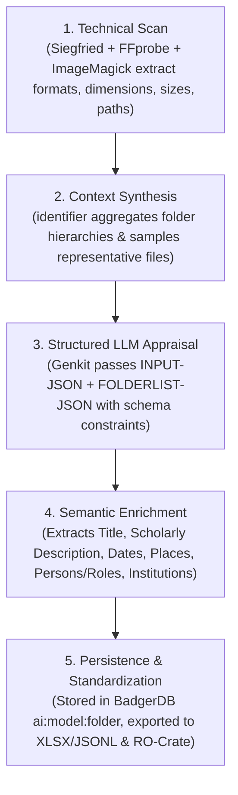

# AI-Assisted Archival Appraisal & Semantic Exploration Guide ("Erschliessung")

This guide provides an in-depth explanation of how **`identifier`** leverages Large Language Models (LLMs) and structured AI flows to explore, appraise, describe, and index weakly structured digital collections, archival estates ("Vor- und Nachlässe"), and research datasets.

---

## Table of Contents

- [1. The Archival Challenge: Unstructured Digital Estates](#1-the-archival-challenge-unstructured-digital-estates)
- [2. The Concept of AI-Driven "Erschliessung"](#2-the-concept-of-ai-driven-erschliessung)
- [3. Architecture & LLM Provider Ecosystem](#3-architecture--llm-provider-ecosystem)
  - [Firebase Genkit Integration](#firebase-genkit-integration)
  - [Supported LLM Providers](#supported-llm-providers)
  - [API Key Management & Environment Variables](#api-key-management--environment-variables)
- [4. The Data Extraction & Sampling Pipeline](#4-the-data-extraction--sampling-pipeline)
  - [From Technical Metadata to Semantic Context](#from-technical-metadata-to-semantic-context)
  - [Hierarchical Folder Aggregation](#hierarchical-folder-aggregation)
  - [Intelligent File Sampling (`--max-files`)](#intelligent-file-sampling---max-files)
  - [Batching & Scalability (`--result-folder`)](#batching--scalability---result-folder)
- [5. Prompt Engineering & Schema Enforcement](#5-prompt-engineering--schema-enforcement)
  - [The Default Archival Appraisal Prompt](#the-default-archival-appraisal-prompt)
  - [Structured Output Schema (`AIResultStruct`)](#structured-output-schema-airesultstruct)
  - [Domain Customization (`--query` and `--additional-query`)](#domain-customization---query-and---additional-query)
- [6. Persistence & Offline Querying](#6-persistence--offline-querying)
  - [BadgerDB Model Namespacing](#badgerdb-model-namespacing)
  - [Retrieving AI Metadata (`identifier ai list`)](#retrieving-ai-metadata-identifier-ai-list)
- [7. Packaging into RO-Crate 1.1 Metadata](#7-packaging-into-ro-crate-11-metadata)
  - [Mapping to Schema.org and RO-Crate Specification](#mapping-to-schemaorg-and-ro-crate-specification)
  - [Executing `identifier ai ro-crate`](#executing-identifier-ai-ro-crate)
- [8. Practical Walkthrough & Real-World Example](#8-practical-walkthrough--real-world-example)
- [9. Best Practices, Privacy & Cost Optimization](#9-best-practices-privacy--cost-optimization)

---

## 1. The Archival Challenge: Unstructured Digital Estates

When cultural memory institutions, archives, and libraries receive digital donations from artists, scientists, institutions, or private individuals, the incoming digital media rarely follows formalized cataloging standards. Instead, archivists face:

- Deep, inconsistent folder structures representing personal organizational habits.
- Cryptic filenames, abbreviations, dates, and version numbers embedded in filenames.
- Mixed multimedia formats (audio recordings, scores, sheet music, drafts, correspondence, photographs, digitized press clippings).
- Tens of thousands of files where manual item-by-item description is economically impossible.

In traditional archival science, **"Erschliessung"** (archival processing and appraisal) creates order, extracts provenance, identifies key persons and institutions, defines temporal coverage, and formulates concise summaries of archival series and files. `identifier` automates this process by using AI to analyze the technical structure and filenames of digital collections.

---

## 2. The Concept of AI-Driven "Erschliessung"

Rather than sending full multi-gigabyte binary files across external networks, `identifier` implements a **metadata-first heuristic**:



By analyzing path semantics, folder groupings, dates in filenames, and technical formats (e.g. 24-bit 96kHz master WAV files vs. PDF scores), the LLM can deduce with high accuracy what a folder contains, when it was produced, who created it, and what historical or scientific event it documents.

---

## 3. Architecture & LLM Provider Ecosystem

### Firebase Genkit Integration

`identifier` is built on **[Firebase Genkit for Go](https://github.com/firebase/genkit/tree/main/go)** (`github.com/firebase/genkit/go`), a framework for building AI-powered workflows with typed inputs and structured JSON schema enforcement.

### Supported LLM Providers

The `--model` flag uses the format `<provider>/<model-name>`:

| Provider | Syntax Example | Description |
|---|---|---|
| **Google AI / Gemini** | `googleai/gemini-2.5-flash`<br>`googleai/gemini-1.5-pro` | Direct Google GenAI API integration with long context windows and fast inference. |
| **OpenAI** | `openai/gpt-4o`<br>`openai/gpt-4o-mini` | Direct OpenAI API integration. |
| **CEDA LiteLLM** | `ceda/gpt-4o`<br>`ceda/llama-3.3-70b` | University of Basel Center for Data Analysis & HPC LiteLLM gateway (`https://llm-api-h200.ceda.unibas.ch/litellm`). |

### API Key Management & Environment Variables

To protect sensitive API tokens from command-line history and process inspection, `identifier` supports environment variable expansion via `%%VARIABLE_NAME%%` syntax:

```shell
# Set environment variable
export GEMINI_API_KEY="AIzaSy..."

# Reference in identifier command
identifier ai --database C:/data/db --model "googleai/gemini-2.5-flash" --apikey "%%GEMINI_API_KEY%%"
```

---

## 4. The Data Extraction & Sampling Pipeline

### From Technical Metadata to Semantic Context

Before running `identifier ai`, `identifier index` scans the directory tree using the [`ocfl-archive/indexer`](https://github.com/ocfl-archive/indexer/blob/master) library (see [Indexer Documentation](https://github.com/ocfl-archive/indexer/blob/master/docs)) and populates BadgerDB with `file:<relative_path>` records containing `FileData`:
- File size, modification time, last seen timestamp.
- PRONOM format identifier and MIME type.
- Media dimensions (width, height, duration).
- SHA-512 checksum and duplicate flag.

### Hierarchical Folder Aggregation

When `identifier ai` executes, it iterates through all `file:*` keys in BadgerDB and groups files into an in-memory dictionary of `folderT` structs:

```go
type folderT struct {
    NumberOfFiles int        // Total file count in this folder
    FileExcerpt   fileList   // Sampled list of file records
    SubFolders    []string   // Direct subfolder names
    FolderName    string     // Normalized relative folder path
}
```

### Intelligent File Sampling (`--max-files`)

If a folder contains hundreds or thousands of files, sending all file records would exceed token limits and increase cost. `identifier` applies a random sampling algorithm (`maxExcerpts(num)`) to select a representative excerpt of files (default: 8 files per folder, customizable via `--max-files`):

```shell
# Increase sample size for complex multi-format directories
identifier ai --database C:/data/db --max-files 15
```

### Batching & Scalability (`--result-folder`)

To process collections with hundreds of directories, `identifier` batches folders into chunks of `--result-folder` (default: 50 folders per prompt). This optimizes token throughput while preventing payload truncation.

---

## 5. Prompt Engineering & Schema Enforcement

### The Default Archival Appraisal Prompt

The built-in prompt is tuned for academic and archival neutrality:

```
Create metadata based on the "INPUT-JSON" metadata for each folder listed in "FOLDERLIST-JSON".
Ensure that each folder appears exactly once in the output.

If folders or filenames contain semantics, use them for title and description.
If folders or filenames indicate location or dates, populate these fields accordingly.
Date format must strictly be "YYYY-MM-DD", "YYYY", or ranges as "YYYY - YYYY".
Do not use other date formats or alphabetic characters in the date field.

The fields "place" and "date" are optional, but should be filled when information is available.
Populate the "tags" field with relevant classifications. Allowed tags include:
"audio", "video", "text", "image", "unknown".

The "persons" list contains Person structures with "name" in "Lastname, Firstname" format
and an optional "role" field.
Institutions should be listed in "institutions" in "Name, Place" format (place optional).
Metadata language must be English with an academic/scholarly style.
Strictly adhere to the output JSON format.
```

### Structured Output Schema (`AIResultStruct`)

Genkit enforces typed output matching the Go `AIResultStruct` schema:

```go
type AIResultStruct struct {
    Folder       string     `json:"folder"`       // Target folder path
    Title        string     `json:"title"`        // Scientific title of folder contents
    Description  string     `json:"description"`  // Scholarly summary of contents and context
    Place        string     `json:"place"`        // Location (e.g. "Basel, Switzerland")
    Date         string     `json:"date"`         // "1964", "1974 - 1984", "1973-05-13"
    Tags         []string   `json:"tags"`         // ["audio", "text", "image"]
    Persons      []AIPerson `json:"persons"`      // [{"name": "Miller, Alexander", "role": "Composer"}]
    Institutions []string   `json:"institutions"` // ["Symphony Orchestra, City A", "Cultural Foundation"]
}
```

### Domain Customization (`--query` and `--additional-query`)

For specialized collections (e.g. architectural archives, medieval manuscripts, medical histories), you can override or extend the prompt:

#### 1. Prepending Domain Context (`--additional-query`):

Create `estate_context.txt`:
```text
Context: This estate belongs to a 20th-century composer and conductor (1932–2013).
Special focus: Identify concert locations, festival compositions, and collaborating musicians.
```

Run with additional query:
```shell
identifier ai --database C:/data/db --additional-query estate_context.txt
```

#### 2. Full Query Replacement (`--query`):

Provide a complete custom prompt file:
```shell
identifier ai --database C:/data/db --query my_custom_prompt.txt
```

---

## 6. Persistence & Offline Querying

### BadgerDB Model Namespacing

Every generated result is stored in the BadgerDB key-value store under a model-specific namespace:

```
Key:   ai:<model-name>:<folder-path>
Value: JSON-encoded AIResultStruct
```

Example:
```
ai:googleai/gemini-2.5-flash:Music Archive/1964 Festival March
```

This namespacing allows you to run multiple models (e.g. compare Gemini 2.5 Flash against GPT-4o) within the same database without data collisions.

### Retrieving AI Metadata (`identifier ai list`)

Once generated, descriptions can be queried offline and exported to multiple formats:

```shell
# Export to Excel spreadsheet for archival review
identifier ai list --database C:/data/db --xlsx C:/data/ai_review.xlsx

# Export to JSON Lines for programmatic ingest into catalog systems
identifier ai list --database C:/data/db --jsonl C:/data/ai_metadata.jsonl

# Filter by folder path prefix
identifier ai list --database C:/data/db --prefix "Concerts" --console
```

---

## 7. Packaging into RO-Crate 1.1 Metadata

[Research Object Crate (RO-Crate)](https://www.researchobject.org/ro-crate/) is a community standard based on JSON-LD and Schema.org for packaging research data and digital heritage with machine-readable metadata.

### Mapping to Schema.org and RO-Crate Specification

`identifier ai ro-crate` automatically maps AI descriptions and filesystem relationships into `ro-crate-metadata.json`:

```json
{
  "@context": "https://w3id.org/ro/crate/1.1/context",
  "@graph": [
    {
      "@id": "ro-crate-metadata.json",
      "@type": "CreativeWork",
      "conformsTo": {
        "@id": "https://w3id.org/ro/crate/1.1"
      },
      "about": {
        "@id": "."
      }
    },
    {
      "@id": ".",
      "@type": ["Dataset"],
      "name": "Legacy Composer Estate",
      "hasPart": [
        { "@id": "1964 Festival March/" },
        { "@id": "1967 Concert Tour/" }
      ]
    },
    {
      "@id": "1964 Festival March/",
      "@type": ["Dataset"],
      "name": "1964 Festival March Edition",
      "description": "Sheet music, piano arrangements, and master audio recordings for the festival march composed in 1964.",
      "datePublished": "1964",
      "contentLocation": "Basel, Switzerland",
      "keywords": ["audio", "text", "sheet music", "festival"]
    }
  ]
}
```

### Executing `identifier ai ro-crate`

```shell
identifier ai ro-crate C:/data/collection \
  --database C:/data/db \
  --model "googleai/gemini-2.5-flash"
```

If `ro-crate-metadata.json` does not exist in the collection root, `identifier` creates the baseline envelope and populates all entity graph nodes, parent-child relationships, and metadata descriptions.

---

## 8. Practical Walkthrough & Real-World Example

### Scenario: Processing a Composer's Legacy Estate

#### Step 1: Initialize Database and Index Technical Metadata

```shell
identifier index C:/data/estate_collection \
  --database C:/data/estate_db \
  --concurrent 4
```

#### Step 2: Generate AI Descriptions

```shell
identifier ai \
  --database C:/data/estate_db \
  --model "googleai/gemini-2.5-flash" \
  --apikey "%%GEMINI_API_KEY%%" \
  --console
```

#### Observed Output:

```
folder: 1964 Festival March
title: 1964 Composition 'Festival March'
description: Manuscript score, piano reductions, and audio recordings of the festival march.
place: Basel, Switzerland
date: 1964
tags: audio; text
persons: Miller, Alexander (Composer) -- Smith, Robert (Publisher)
institutions: Cultural Committee Basel
```

#### Step 3: Embed into RO-Crate

```shell
identifier ai ro-crate C:/data/estate_collection \
  --database C:/data/estate_db \
  --model "googleai/gemini-2.5-flash"
```

The resulting `ro-crate-metadata.json` is ready for archival long-term storage in an OCFL repository or digital asset management system (DAMS).

---

## 9. Best Practices, Privacy & Cost Optimization

1. **Perform Sanitization Before Indexing**:
   - Always run `identifier clearpath --auto --rename` before `identifier index` and `identifier ai`. Sanitized filenames eliminate encoding artifacts that confuse LLMs.
2. **Optimize Sampling Size (`--max-files`)**:
   - For folders with homogeneous files (e.g. photo sessions), `--max-files 4` is sufficient.
   - For heterogeneous folders (e.g. project files with mixed media), use `--max-files 10` to `15`.
3. **Data Privacy & GDPR**:
   - `identifier ai` transmits **metadata and filenames only** (no file payload bytes are transmitted).
   - If filenames contain confidential personal data, consider using an institutional on-premise endpoint via `--model "ceda/..."` or a local LiteLLM proxy.
4. **Iterative Prompt Refinement**:
   - Use `--prefix` to test your prompts on a small subset of directories before running appraisal across the entire collection.
   - Example: `identifier ai --database C:/data/db --prefix "1964" --console`
