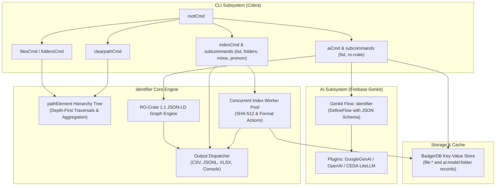
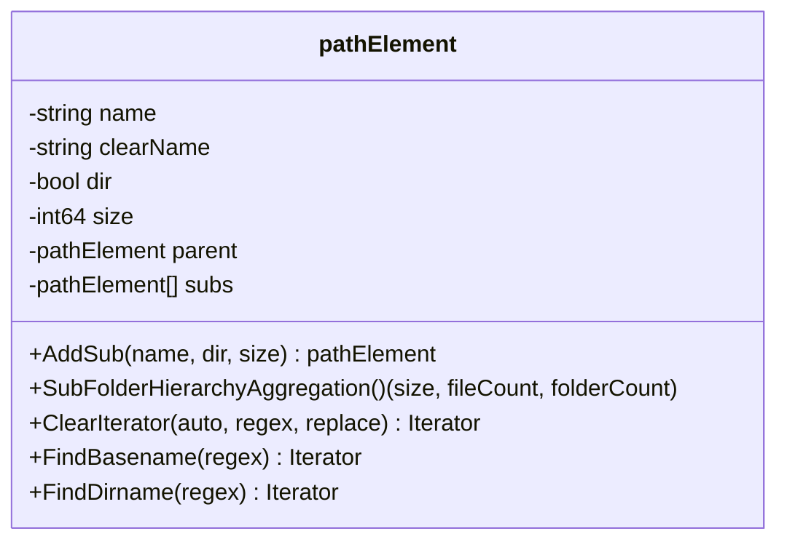
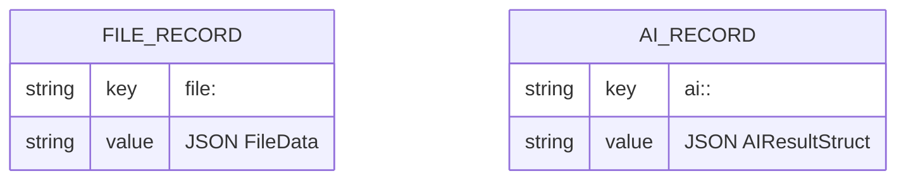
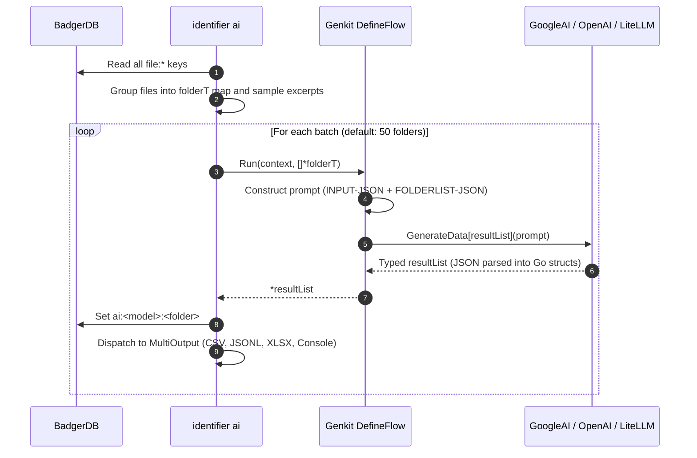

# identifier Architecture & Component Design

This document details the internal design, concurrency model, data structures, and storage subsystems of **`identifier`**.

---

## Component Architecture



---

## Data Structures

### 1. `FileData` (`identifier/structures.go`)

Encapsulates complete filesystem attributes and technical characterization results for an individual file:

```go
type FileData struct {
    Path      string            `json:"path,omitempty"`      // Relative slash-separated path
    Folder    string            `json:"folder,omitempty"`    // Containing relative folder
    Basename  string            `json:"basename,omitempty"`  // Filename
    Size      int64             `json:"size,omitempty"`      // Size in bytes
    Duplicate bool              `json:"duplicate,omitempty"` // Flagged if SHA-512 matches earlier file
    LastMod   int64             `json:"lastmod,omitempty"`   // File modification Unix timestamp
    Indexer   *indexer.ResultV2 `json:"indexer,omitempty"`   // Technical indexer results
    LastSeen  int64             `json:"lastseen,omitempty"`  // Scan timestamp
}
```

### 2. `AIResultStruct` (`identifier/structures.go`)

Holds LLM-generated descriptive metadata for a folder:

```go
type AIResultStruct struct {
    Folder       string     `json:"folder"`
    Title        string     `json:"title"`
    Description  string     `json:"description"`
    Place        string     `json:"place,omitempty"`
    Date         string     `json:"date,omitempty"`
    Tags         []string   `json:"tags,omitempty"`
    Persons      []AIPerson `json:"persons,omitempty"`
    Institutions []string   `json:"institutions,omitempty"`
}
```

### 3. `pathElement` (`identifier/clearpath.go`)

An in-memory n-ary tree node representing files and directories for recursive aggregation, regex queries, and post-order traversal renaming:



---

## BadgerDB Storage Architecture

`identifier` uses BadgerDB as an embedded, LSM-tree-based, zero-allocation key-value store with Snappy compression.



### Key Formats & Semantics:
- **`file:<relative_path>`**: Stores technical metadata indexed from the filesystem. If a file's size and modification timestamp match an existing record during re-indexing, the cached index result is loaded instantly.
- **`ai:<model_name>:<relative_folder>`**: Stores structured semantic descriptions produced by LLMs. Namespacing by model allows comparative evaluation across different models without data loss.

---

## Genkit Flow Execution Pipeline


