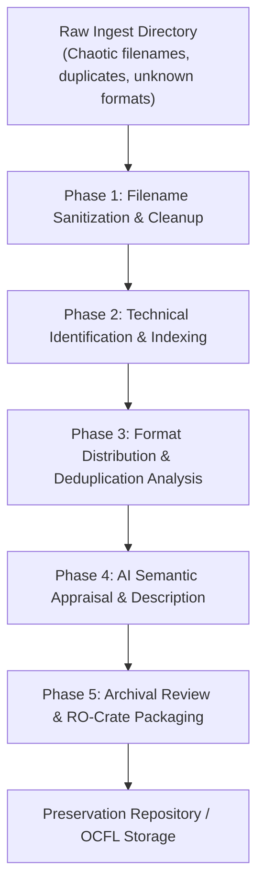
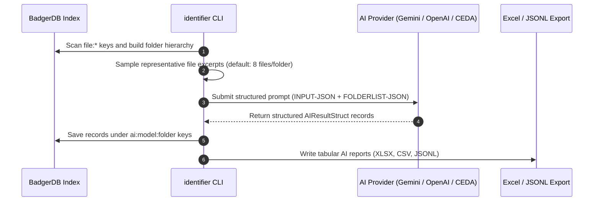

# Archival Processing & Data Ingestion Workflow Guide

This guide describes a complete end-to-end operational workflow for processing an uncurated digital estate, research collection, or donation package using **`identifier`**.

---

## Archival Ingestion Lifecycle Overview



---

## Step 1: Pre-Ingest Inspection & Filename Sanitization

Uncurated filesystems often contain illegal characters for Unix or Windows environments, leading spaces, typographic quotes, and Unicode Private Use Area (PUA) glyphs.

### 1.1 Dry-Run Inspection
Always preview proposed renames without modifying files:
```shell
identifier clearpath /data/ingest --auto
```

### 1.2 Execute Sanitization
Apply the bottom-up depth-first sanitization:
```shell
identifier clearpath /data/ingest --auto --rename
```

### 1.3 Remove Operating System Artifacts
Remove hidden system files, thumbnail databases, and resource forks:
```shell
# Remove AppleDouble and dot files
identifier files /data/ingest --regexp "^\._" --remove
identifier files /data/ingest --regexp "^\.DS_Store$" --remove

# Remove empty folders
identifier folders /data/ingest --regexp "^__MACOSX$" --remove
```

---

## Step 2: Technical Indexing & BadgerDB Caching

Run technical identification across all files in parallel using the embedded worker pool (powered by [indexer](https://github.com/ocfl-archive/indexer/blob/master); see [Indexer Documentation](https://github.com/ocfl-archive/indexer/blob/master/docs)):

```shell
identifier index /data/ingest \
  --database /data/cache_db \
  --concurrent 4 \
  --jsonl /data/reports/index.jsonl \
  --csv /data/reports/index.csv \
  --xlsx /data/reports/index.xlsx \
  --console
```

The indexing phase computes SHA-512 cryptographic hashes, queries Siegfried for PRONOM IDs (`fmt/...`), inspects audio/video streams with FFprobe, and checks image dimensions with ImageMagick. For detailed configuration of each indexer tool and action, refer to the [Indexer Documentation](https://github.com/ocfl-archive/indexer/blob/master/docs).

---

## Step 3: Format Analysis & Deduplication

### 3.1 MIME Type & PRONOM Profile
Generate format distribution statistics directly from the database cache:
```shell
identifier index mime --database /data/cache_db --console
identifier index pronom --database /data/cache_db --console
```

### 3.2 Duplicate Detection
Inspect identical duplicate files across different directories:
```shell
identifier index list --database /data/cache_db --duplicates --console --xlsx /data/reports/duplicates.xlsx
```

---

## Step 4: AI Semantic Appraisal ("Erschliessung")

Use Large Language Models via Firebase Genkit to infer provenance, titles, scholarly descriptions, temporal boundaries, and entity relationships:



### 4.1 Running AI Appraisal

```shell
export GEMINI_API_KEY="AIzaSy..."

identifier ai \
  --database /data/cache_db \
  --model "googleai/gemini-2.5-flash" \
  --apikey "%%GEMINI_API_KEY%%" \
  --xlsx /data/reports/ai_descriptions.xlsx \
  --console
```

---

## Step 5: Packaging into RO-Crate 1.1

Embed the extracted technical metadata and AI descriptions into a standardized `ro-crate-metadata.json` descriptor:

```shell
identifier ai ro-crate /data/ingest \
  --database /data/cache_db \
  --model "googleai/gemini-2.5-flash"
```

The resulting dataset contains full Schema.org annotations and is ready for transfer into an Oxford Common File Layout (OCFL) archival storage tier.
